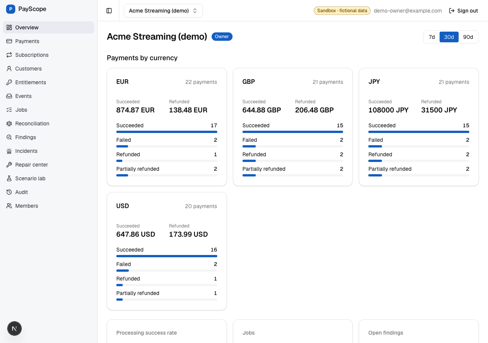
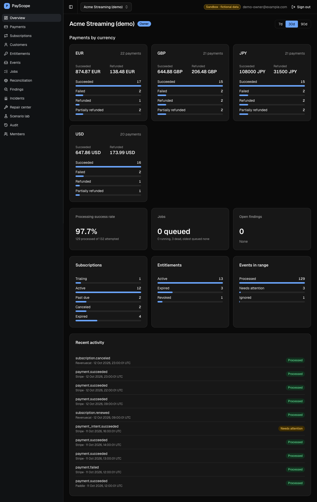
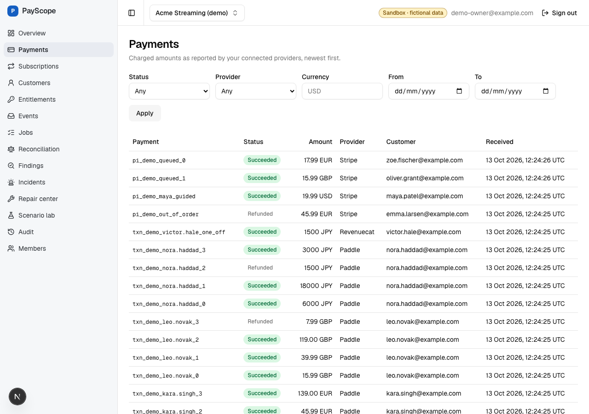
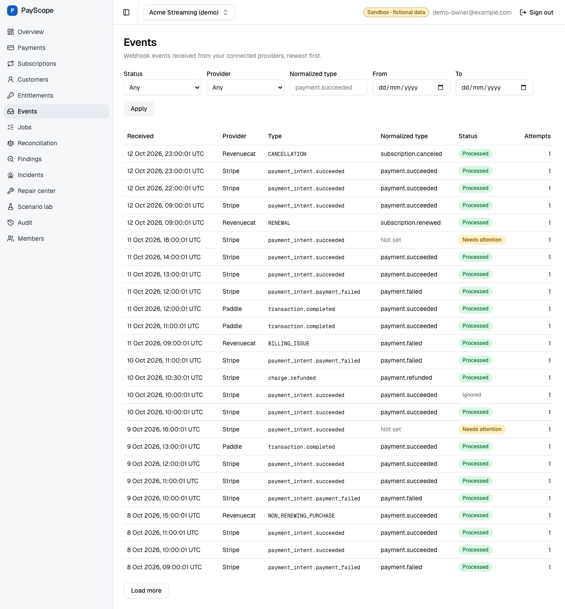
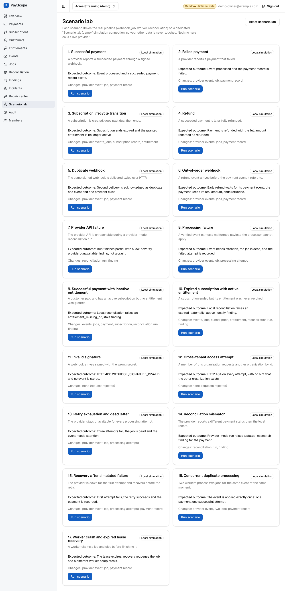
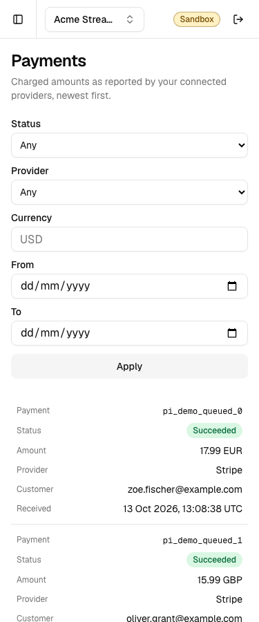

# PayScope

PayScope is a payment operations console for teams that sell through Stripe, PayPal, Paddle, and RevenueCat.
It ingests signed provider webhooks, processes them through a Postgres-backed job queue, and keeps payments, subscriptions, customers, and entitlements consistent.
Reconciliation detects drift between those records, and a repair center fixes it with audited, idempotent actions.

This is a portfolio prototype.
All data is fictional, every seeded connection is in simulation mode, and no provider credentials are configured.
The provider adapters are written against official docs but not verified against live sandboxes (capability `implemented_unverified`).

## What works today

- Webhook ingress with raw-body signature verification, a replay window, and exactly-once event storage.
- A worker that claims jobs with `FOR UPDATE SKIP LOCKED`, retries with backoff, recovers expired leases, and dead-letters exhausted jobs.
- Ordering-safe event processing into payment, subscription, customer, and entitlement records.
- Local-rule reconciliation, plus provider-mode reconciliation when a connection has a sandbox API key.
- Findings, incidents, a repair center, and an append-only audit log.
- Multi-tenant orgs with OWNER, ADMIN, OPERATOR, and VIEWER roles.
- A scenario lab with 17 repeatable simulations on the real pipeline (see [docs/demo.md](docs/demo.md)).

See [IMPLEMENTATION_STATUS.md](IMPLEMENTATION_STATUS.md) for what is real, simulated, planned, or blocked.

## Screenshots

Captured from the running app on seeded demo data by the Playwright visual sweep.

| Overview                                                   | Overview, dark                                                     |
| ---------------------------------------------------------- | ------------------------------------------------------------------ |
|       |   |
| Payments                                                   | Events                                                             |
|       |              |
| Scenario lab                                               | Payments, mobile                                                   |
|  |  |

## Demo

[docs/demo-script.md](docs/demo-script.md) is a five-minute walkthrough of the guided case and the scenario lab.
Reset the local demo before each run with `pnpm demo:reset`.

## Local setup

Needs Node 24 (`.nvmrc`), pnpm 12, and a local PostgreSQL 17 or newer (Homebrew or `docker compose up -d`).

```bash
createdb payscope
cp .env.example .env.local
pnpm install
pnpm --filter @payscope/api db:migrate && pnpm db:seed
pnpm dev
```

Before step 4, edit `.env.local`:

- `DATABASE_URL`: on Homebrew Postgres there is no `postgres` role, so use `postgresql://localhost:5432/payscope` (your OS user).
- `CREDENTIALS_ENCRYPTION_KEY`: generate with `openssl rand -base64 32`; the seed, webhook, and connection routes need it.
- `SUPABASE_URL`, `NEXT_PUBLIC_SUPABASE_URL`, `NEXT_PUBLIC_SUPABASE_PUBLISHABLE_KEY`: a real Supabase project URL and publishable key, since the API refuses to start with the placeholder URL.

The API scripts and the web app read the repo-root `.env.local` themselves; variables already set in the shell take precedence.

The web app runs on http://localhost:3000 and the API on http://localhost:3001 (`/health`, `/ready`).
Signing in uses Supabase Auth, so the four demo users must exist in your Supabase project with the ids in `packages/api/src/seed/seed-identity.ts`.
Their password is not in the repo; see [docs/demo.md](docs/demo.md).

## Commands

| Command                                     | Purpose                                                        |
| ------------------------------------------- | -------------------------------------------------------------- |
| `pnpm test`                                 | Unit and integration tests (needs `TEST_DATABASE_URL`)         |
| `pnpm lint`, `pnpm typecheck`, `pnpm build` | Same gates as CI                                               |
| `pnpm demo:reset`                           | Migrate, then delete and re-seed only the two demo orgs        |
| `pnpm db:reset-demo`                        | Delete and re-seed only the two demo orgs                      |
| `pnpm --filter @payscope/api worker`        | Standalone worker (set `RUN_WORKER_IN_PROCESS=false`)          |
| `pnpm e2e`                                  | Playwright suite, see [docs/operations.md](docs/operations.md) |

## Docs

- [docs/architecture.md](docs/architecture.md): packages, request and worker flow, tenancy, money.
- [docs/api.md](docs/api.md): routes, auth, errors.
- [docs/deployment.md](docs/deployment.md): hosting plan, env vars, what is not configured yet.
- [docs/database.md](docs/database.md), [docs/security.md](docs/security.md), [docs/backend-performance.md](docs/backend-performance.md), [docs/operations.md](docs/operations.md), [docs/demo.md](docs/demo.md), [docs/demo-script.md](docs/demo-script.md), [docs/provider-research.md](docs/provider-research.md).

## Limitations

- No hosted deployment exists yet; the stack runs locally only.
- No provider sandbox credentials are configured, so provider-mode reconciliation and real sandbox webhooks are untested end to end.
- Scenario lab runs are local simulations; the provider failure scenarios use an in-lab fake fetch.
- The planned free hosts sleep and pause (Render after 15 minutes idle, Supabase Free after 7 days of low activity), see [docs/deployment.md](docs/deployment.md).
