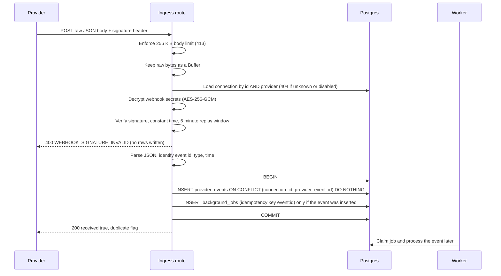

# Architecture

## Webhook ingress

Provider webhooks arrive at `POST /webhooks/:provider/:connectionId`.
The route is outside `/api/v1` and has no user authentication; the signature is the credential.
It lives in an encapsulated Fastify plugin with its own buffer JSON parser and a 256 KiB body limit.

## Guarantees

Invalid signatures never create a row, a job, or any other work.
The raw request bytes are verified, never a re-serialized body.
The event row is committed before the provider receives a 2xx.
Deduplication is decided by the `provider_events_connection_event_unique` constraint, so concurrent deliveries of one event produce exactly one event row.
The job is inserted in the same transaction as the event, so an event never exists without its job.
A duplicate delivery writes nothing, enqueues nothing, and still returns 200.
No event processing runs in the request handler; the worker owns it.
No external HTTP call happens inside the database transaction.
Unsupported event types are persisted with `normalized_type` set to `unsupported` so the worker can mark them ignored.
Live-mode or otherwise invalid-input events get a 422 and persist nothing.
Logs carry the provider, connection id, and failure reason only; never the body, headers, signature, or secrets.

## Job worker

Background work runs from the `background_jobs` table; Postgres is the queue.
A worker claims jobs with one `UPDATE ... WHERE id IN (SELECT ... FOR UPDATE SKIP LOCKED)` statement, so concurrent workers never receive the same job.
The claim sets `status = running`, `locked_by`, a lease expiry, and increments `attempt_count` in that same statement.
Completing or failing a job is conditional on `status = running AND locked_by = <worker>`, so a worker that lost its lease cannot overwrite state and learns this from a `false` return.
A lost lease is logged and never thrown.
While a handler runs longer than half the lease, the worker extends the lease with the same ownership condition, so slow jobs are not run twice.
No database transaction is held across a handler.
Recovery is a single `UPDATE` that moves running jobs with an expired lease back to `queued`, or to `dead` once attempts are exhausted, and clears `locked_by`.
The worker recovers on start and every 30 polls.
Retryable failures return to `queued` with `available_at` set by exponential backoff with full jitter (base 5 seconds, cap 15 minutes).
A failure is retryable for a retryable `ProviderError` or any unknown error; a non-retryable `ProviderError` or a `PermanentJobError` goes straight to `dead`.
A job also goes to `dead` when `attempt_count` reaches `max_attempts`, and an unknown job kind goes to `dead` with `unsupported_job_kind`.
`dead` is the dead-letter state: the row stays with a sanitized `last_error` truncated to 1000 characters and is never retried automatically.
Logs carry the job id, kind, attempt, duration, and outcome; never the payload.
The `process_provider_event` handler re-normalizes the stored payload, stores `normalized_type`, marks the event `processed` (or `ignored` for unsupported types), and writes an `event_processing_attempts` row.
It does not apply record state changes yet.

### Hosting modes

By default the worker runs inside the API process (`RUN_WORKER_IN_PROCESS=true`) and is stopped before the database pool closes on shutdown.
The same worker is importable as its own process: `pnpm --filter @payscope/api worker`, or `node dist/worker-main.js` after a build.
Set `RUN_WORKER_IN_PROCESS=false` on the API when running a standalone worker.
`POST /internal/tick` runs one recovery pass and one drain pass for hosts that sleep between requests.
It requires the `x-internal-token` header, compared in constant time to `INTERNAL_TICK_TOKEN`, and is not registered when the token is unset.

## Credentials at rest

Webhook secrets and API keys are stored as one AES-256-GCM blob in `provider_connections.credentials_ciphertext`.
The layout is a version byte, a 12-byte random IV, the ciphertext, and a 16-byte tag.
The connection id is bound as additional authenticated data, so a blob cannot be moved to another row.
The key comes from `CREDENTIALS_ENCRYPTION_KEY` (base64, 32 bytes) and is required in production.
At most two webhook secrets are kept per connection, so a rotation accepts the old and new secret together.
The connections API returns `hasWebhookSecret` and `hasApiKey` and never returns secrets or ciphertext.
Only sandbox API keys are accepted.
