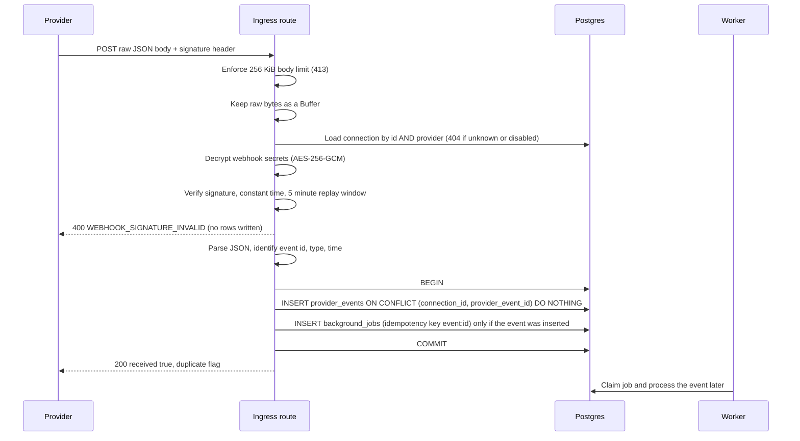

# Architecture

## Packages

| Package                       | Role                                                                                       |
| ----------------------------- | ------------------------------------------------------------------------------------------ |
| `@payscope/web`               | Next.js app. Signs users in with Supabase Auth and calls the API with the access token.    |
| `@payscope/api`               | Fastify API, the job worker, migrations, seed, and the credential rotation CLI.            |
| `@payscope/shared`            | Zod request and response schemas, the role permission matrix, and money helpers.           |
| `@payscope/provider-adapters` | Stripe, PayPal, Paddle, and RevenueCat signature verification, normalization, and fetches. |
| `@payscope/test-utils`        | Test JWT signer and fixed clock.                                                           |
| `@payscope/e2e`               | Playwright suite against the real web, API, worker, and local Postgres.                    |

Migrations live in `supabase/migrations`, are generated by drizzle-kit, and run on Supabase and plain Postgres alike.

## End-to-end flow

1. A provider posts a webhook to `/webhooks/:provider/:connectionId`.
   Ingress verifies the signature on the raw bytes, then stores the event and a `process_provider_event` job in one transaction.
2. The worker claims the job from `background_jobs`, normalizes the payload, and applies it to records in one transaction.
3. A user starts a reconciliation run through the API.
   The worker runs it as a `run_reconciliation` job and writes findings, and high or critical findings open incidents.
4. An operator reviews findings and runs repairs, each audited and idempotent.
5. The web app reads everything through `/api/v1`, never through the Supabase Data API.

The worker runs inside the API process by default; see "Job worker" below.

## Tenancy and authorization

Every tenant-scoped row carries `org_id`.
The API verifies the Supabase access token (JWT, checked against the project JWKS), then `requireOrg` loads the caller's membership for the `:orgId` in the path.
A non-member gets `404`, so another org's existence is never revealed; a member without the permission gets `403`.
Permissions come from one matrix in `packages/shared/src/permissions.ts`: VIEWER reads, OPERATOR also retries, reconciles, repairs, and runs scenarios, ADMIN also manages members and connections, and OWNER can do everything.
Every repository query also filters by `org_id`.

The API connects as a privileged role, so row level security does not constrain it.
RLS is defense in depth for the Supabase Data API: `authenticated` gets `SELECT` only, through `app.is_org_member(org_id)` policies, and no write policies.
See [database.md](database.md) for the per-table detail.

## Money

Amounts are integer minor units end to end: `bigint` columns such as `amount_minor`, `bigint` in TypeScript, and digit strings in JSON.
No floating point is used for money.
`packages/shared/src/money.ts` converts provider decimal strings with ISO 4217 exponents (0 for JPY, 3 for KWD, 2 by default) and formats for display.

## Webhook ingress

Provider webhooks arrive at `POST /webhooks/:provider/:connectionId`.
The route is outside `/api/v1` and has no user authentication; the signature is the credential.
It lives in an encapsulated Fastify plugin with its own buffer JSON parser and a 256 KiB body limit.

## Guarantees

Invalid signatures never create a row, a job, or any other work.
The raw request bytes are verified, never a re-serialized body.
The event row is committed before the provider receives a 2xx.
Deduplication is decided by the `provider_events_connection_event_unique` constraint, so concurrent deliveries of one event produce exactly one event row.
The job is inserted in the same transaction as the event, so an event never exists without its job.
A duplicate delivery writes nothing, enqueues nothing, and still returns 200.
No event processing runs in the request handler; the worker owns it.
No external HTTP call happens inside the database transaction.
Unsupported event types are persisted with `normalized_type` set to `unsupported` so the worker can mark them ignored.
Live-mode or otherwise invalid-input events get a 422 and persist nothing.
Logs carry the provider, connection id, and failure reason only; never the body, headers, signature, or secrets.

## Job worker

Background work runs from the `background_jobs` table; Postgres is the queue.
A worker claims jobs with one `UPDATE ... WHERE id IN (SELECT ... FOR UPDATE SKIP LOCKED)` statement, so concurrent workers never receive the same job.
The claim sets `status = running`, `locked_by`, a lease expiry, and increments `attempt_count` in that same statement.
Completing or failing a job is conditional on `status = running AND locked_by = <worker>`, so a worker that lost its lease cannot overwrite state and learns this from a `false` return.
A lost lease is logged and never thrown.
While a handler runs longer than half the lease, the worker extends the lease with the same ownership condition, so slow jobs are not run twice.
No database transaction is held across a handler.
Recovery is a single `UPDATE` that moves running jobs with an expired lease back to `queued`, or to `dead` once attempts are exhausted, and clears `locked_by`.
The worker recovers on start and every 30 polls.
Retryable failures return to `queued` with `available_at` set by exponential backoff with full jitter (base 5 seconds, cap 15 minutes).
A failure is retryable for a retryable `ProviderError` or any unknown error; a non-retryable `ProviderError` or a `PermanentJobError` goes straight to `dead`.
A job also goes to `dead` when `attempt_count` reaches `max_attempts`, and an unknown job kind goes to `dead` with `unsupported_job_kind`.
`dead` is the dead-letter state: the row stays with a sanitized `last_error` truncated to 1000 characters and is never retried automatically.
Logs carry the job id, kind, attempt, duration, and outcome; never the payload.
The `process_provider_event` handler re-normalizes the stored payload and applies it as described in "Event processing".

### Hosting modes

By default the worker runs inside the API process (`RUN_WORKER_IN_PROCESS=true`) and is stopped before the database pool closes on shutdown.
The same worker is importable as its own process: `pnpm --filter @payscope/api worker`, or `node dist/worker-main.js` after a build.
Set `RUN_WORKER_IN_PROCESS=false` on the API when running a standalone worker.
`POST /internal/tick` runs one recovery pass and one drain pass for hosts that sleep between requests.
It requires the `x-internal-token` header, compared in constant time to `INTERNAL_TICK_TOKEN`, and is not registered when the token is unset.

## Event processing

The handler normalizes the stored payload outside any transaction, then runs `applyEvent` in one transaction.
That transaction claims the event, applies every record write, and inserts the `event_processing_attempts` row.
A crash therefore cannot leave records applied while the event is still pending.
No external HTTP call happens inside the transaction.

### Claim and idempotency

The first statement is `UPDATE provider_events SET status = 'processed' ... WHERE status IN ('pending', 'processing', 'failed') RETURNING`.
A concurrent duplicate run blocks on that row, then matches nothing, writes nothing, and returns.
An empty claim is a real outcome (`already_handled`), not an error.

### Ordering rule

Every record carries `last_event_at`, the provider `occurredAt` of the last event applied to it.
A write is a guarded upsert: `INSERT ... ON CONFLICT DO UPDATE ... WHERE last_event_at IS NULL OR last_event_at <= EXCLUDED.last_event_at RETURNING`.
The condition and the write are one statement, so a read-then-write race cannot exist.
An empty `RETURNING` means the event is older than the stored state.
The event is then marked `ignored` and the attempt row records `outcome = skipped` with `error_message = stale_event`.
Events with identical timestamps apply in arrival order.
Each applied write increments `version` once.

### Object rules

Payments are keyed by `(connection_id, provider_payment_id)`.
Amount and currency are set on insert and never overwritten.
A refund sets `amount_refunded_minor`, capped at `amount_minor`, and the status becomes `refunded` or `partially_refunded`.
Stripe refund amounts are cumulative; other providers' refund amounts are added.
A refund never creates a payment, because it carries only the refunded amount.
A refund for an unknown payment fails as `transient` and retries with backoff until the payment event has arrived; a refund that names entitlement keys still revokes them and is noted `refund_payment_unknown`.
Subscriptions are keyed by `(connection_id, provider_subscription_id)` and take `current_period_end` from event metadata when present.
A subscription event with no provider customer for an unknown subscription fails with `state_conflict` and the event needs attention.
Customers are resolved through `provider_customer_mappings`; a missing mapping creates a `customers` row in the same transaction, and a lost race deletes that row and re-selects the winner.
A dispute marks the matching payment `disputed`; with no matching payment the event is still `processed` and the attempt row carries a note, so no orphan rows are created.

### Entitlement policy

Entitlements are written only for events that carry `entitlementKeys`, per key, with source `provider_event`.
Created and renewed events set `active`, keep the original `granted_at`, and set `expires_at` when the event carries an expiry.
An expiration sets `expired`.
A full refund sets `revoked` and `revoked_at`; a partial refund leaves entitlements unchanged.
A cancellation never changes an entitlement: access continues until the expiration event arrives.
Entitlement writes use the same `last_event_at` guard.

Stripe, Paddle and PayPal events carry no entitlement keys.
For them the entitlements are derived in the same transaction as a successful subscription upsert, from the connection's `entitlement_map` (`{ "<planRef>": ["key", ...] }`) and the subscription's `plan_ref`.
`active` and `trialing` set `active` with `expires_at` at the period end; `canceled` stays `active` until the period end and is `expired` once it has passed; `expired` sets `expired`; `past_due` and `paused` leave entitlements unchanged.
A plan with no mapping creates nothing and appends `plan_unmapped` to the attempt row's reason without failing the event.
A payment record stores the provider subscription id its event carries in `provider_subscription_id` (Paddle `subscription_id` on transactions and refund adjustments, PayPal `billing_agreement_id` on captures); Stripe is resolved separately (below).
Stripe payment intents and charges carry no subscription id since API version basil, and `invoice.paid` webhooks omit the includable `payments` list, so no ingested event links a Stripe payment to its subscription.
Instead, before the apply transaction of a refund whose stored payment is still unlinked, the worker asks Stripe once through `GET /v1/invoice_payments?payment[type]=payment_intent&payment[payment_intent]=<pi>&expand[]=data.invoice` and reads `invoice.parent.subscription_details.subscription`.
The lookup is scoped to the event's org and connection, uses the connection's stored credentials and the client's existing timeout and body caps, and is skipped when the payment is already linked or the connection has no usable credentials.
A transient lookup failure fails the event retryably; an empty result means a one-off payment.
The result goes through the same `COALESCE` write as event-carried ids, so an existing link is never cleared.
A full refund without entitlement keys revokes only the active entitlements of that subscription, resolved through `(connection_id, provider_subscription_id)` at refund time, so a payment that arrived before its subscription still links.
A full refund of a payment with no subscription id is a one-off refund and revokes nothing.

### Attempt categories

Every processing try writes one attempt row with `failure_category` taken from the `ProviderError` category: `transient`, `permanent`, `invalid_input`, `provider_auth`, `unsupported_event`, or `state_conflict`.
`not_found` maps to `permanent` and `unavailable` maps to `transient`.
Other errors count as `transient`.
A retryable failure sets the event to `failed` and the job returns to `queued` with backoff.
A non-retryable failure, or a retryable one on the job's last attempt, sets the event to `needs_attention` and the job to `dead`.
The job status `failed` is never written; the Jobs page counts a queued job with `attempt_count > 0` as retrying.
Unsupported event types are `ignored` with `unsupported_event`.

## Provider connection secrets

The ingress route passes the decrypted `webhookSecrets` to `verifyWebhook` unchanged.
Stripe: each secret is a signing secret (`whsec_...`); any of the two may match.
Paddle: each secret is a notification destination secret key; any of the two may match.
RevenueCat: each secret is either the expected `Authorization` header value or an HMAC signing secret.
PayPal: `secrets[0]` is the webhook id from the PayPal developer dashboard, not a signing key.
Live-mode events (Stripe `livemode`, RevenueCat `PRODUCTION`) are rejected with `ProviderError.reason = 'live_mode'`, which ingress turns into a 422.

## Credentials at rest

Webhook secrets and API keys are stored as one AES-256-GCM blob in `provider_connections.credentials_ciphertext`.
The layout is a version byte, a 12-byte random IV, the ciphertext, and a 16-byte tag.
The connection id is bound as additional authenticated data, so a blob cannot be moved to another row.
The key comes from `CREDENTIALS_ENCRYPTION_KEY` (base64, 32 bytes) and is required in production.
At most two webhook secrets are kept per connection, so a rotation accepts the old and new secret together.
The connections API returns `hasWebhookSecret` and `hasApiKey` and never returns secrets or ciphertext.
Only sandbox API keys are accepted.

## Reconciliation

Reconciliation compares local records against local invariants and, optionally, against the provider's authoritative state.
Detection and correction are separate: a run only writes findings, and repairs belong to a later flow.
A finding is never marked `resolved` here; `PATCH` accepts only `reviewed` and `dismissed`.

### Runs

`POST /api/v1/orgs/:orgId/reconciliation/runs` takes `{ connectionId?, mode }` and needs `reconciliation:run`.
It inserts a `reconciliation_runs` row and a `run_reconciliation` job (idempotency key `run:{id}`) in one transaction.
A partial unique index allows one `running` run per `(org, connection)`, with an org-wide run using a zero uuid, so a second request returns 409 `RUN_IN_PROGRESS`.
The worker executes in keyset batches outside any transaction, and each batch writes its findings, count increments, and checkpoint in one short transaction.
The checkpoint stores the current phase, the last keyset cursor, and the provider request count, so a job retry continues from the checkpoint and processes only the remaining rows.
A run ends `completed`, or `partial` when objects were unavailable or failed, the request cap was hit, or the provider rejected the credentials.
A non-retryable error or the last failed attempt ends the run `failed`.

### Local rules

Local mode needs no credentials and makes no provider calls.

| Rule                                                                                                                          | Finding type                        | Subject                             |
| ----------------------------------------------------------------------------------------------------------------------------- | ----------------------------------- | ----------------------------------- |
| Succeeded payment and an active subscription for the customer, but no active entitlement                                      | `entitlement_missing_or_stale`      | customer                            |
| Subscription expired, or canceled with the period ended, but an entitlement is still active                                   | `expired_externally_active_locally` | subscription (plus entitlement key) |
| `amount_refunded_minor > 0` with a status other than refunded or partially refunded, or status refunded with nothing refunded | `refund_inconsistent`               | payment                             |
| Payment or subscription whose customer has zero or several mappings on the connection                                         | `mapping_missing_or_ambiguous`      | payment or subscription             |
| Event stuck in `needs_attention` whose record status contradicts the event type                                               | `status_mismatch`                   | payment or subscription             |

In local mode `examined` and `mismatched` both count the rows a rule flagged.

### Provider mode

Provider mode needs a connection with an API key and an adapter whose `authoritativeFetch` is not `unsupported`.
It calls `fetchPayment` and `fetchSubscription` for each local record with bounded concurrency (default 3) and a per-run request cap (default 200).
Status and amount are compared, with refunded and disputed local payments accepting a provider `succeeded`.

| Provider result              | Outcome                                                                                   |
| ---------------------------- | ----------------------------------------------------------------------------------------- |
| Statuses and amounts agree   | counted as matched                                                                        |
| Disagreement                 | `status_mismatch`, severity high                                                          |
| `not_found`                  | `provider_object_not_found`, severity high                                                |
| `unavailable` or `transient` | `provider_unavailable`, severity low, counted in `unavailable`; never reported as missing |
| `provider_auth`              | run ends `partial` with `provider_auth_failed`                                            |
| Anything else                | counted in `failed`                                                                       |

When the adapter implements `listPayments` (Stripe only today), a final phase lists provider payments created in a window from 30 days before the run started to 5 minutes before it, so payments whose webhook may still be in flight are skipped.
Each listed payment with no local record on the same org and connection raises `provider_payment_missing_locally`, severity high, with the connection as subject and the provider payment id as the fingerprint key.
Each page costs one request against the cap, and the provider cursor is checkpointed so a retry resumes at the next page.
An unavailable listing is counted in `unavailable` and never reported as missing.
Paddle, PayPal, and RevenueCat adapters have no list operation, so they never emit this finding.

### Idempotent findings

The fingerprint is `type:subjectType:subjectId`, plus the entitlement key where one applies.
A partial unique index on `(org_id, fingerprint)` for `open` and `reviewed` findings makes re-detection an `INSERT ... ON CONFLICT DO UPDATE` that refreshes `last_seen_run_id`, `evidence`, and `updated_at`.
Overlapping runs therefore cannot create duplicates.
A dismissed finding that is detected again opens a new finding.

## Repair and audit

### Audit log

Every mutation that changes org state writes an `audit_logs` row through `writeAudit(tx, ...)` inside the same transaction as the change.
A rollback therefore removes the audit row with the mutation, and a committed change always has its row.
`audited()` wraps a handler: success is audited in the work transaction, and a request that passed authorization but was rejected (an `ApiHttpError`) is audited afterwards with outcome `failure`.
Audited actions: org create, member add, role change and remove, ownership transfer, connection create, update (credential rotation, entitlement map), verify, and credential removal, entitlement ingestion, event retry, finding review and dismiss, reconciliation run start, incident actions, scenario run and reset, and the four repairs.
Connection credentials are never stored in audit state, only flags such as `webhookSecretRotated` and `apiKeyRemoved`.

### Repair center

All repairs require `repairs:execute`, a `reason` of 10 to 500 characters, and an `Idempotency-Key` header.
No repair writes to a provider.
Each repair runs in one transaction that holds the idempotency claim, the state change, the finding update, the audit row, and the stored response.
`refresh-from-provider` reads the provider before that transaction, and its write requires the record `version` it read, so a change in between answers `409 CONCURRENT_UPDATE`.

| Endpoint                              | Effect                                                                                                                                                                                                                                                                    |
| ------------------------------------- | ------------------------------------------------------------------------------------------------------------------------------------------------------------------------------------------------------------------------------------------------------------------------- |
| `POST /repairs/reprocess-event`       | Sets a stored event back to `pending` and re-queues its job. Apply-step guards prevent double effects.                                                                                                                                                                    |
| `POST /repairs/correct-entitlement`   | For `entitlement_missing_or_stale` grants the plan-mapped entitlements; for `expired_externally_active_locally` expires the entitlement. Source is `manual_repair`. Marks the finding resolved.                                                                           |
| `POST /repairs/resolve-finding`       | Re-runs the finding's local rule scoped to its subject. Resolves only if the fingerprint is no longer detected, otherwise `409 STILL_DETECTED`. Provider-derived findings answer `422 NOT_LOCALLY_VERIFIABLE`.                                                            |
| `POST /repairs/refresh-from-provider` | Reads one payment or subscription from the provider and overwrites the local status (payment amount and currency too). When the result matches the provider, resolves open or reviewed `status_mismatch` findings on the record and returns them as `resolvedFindingIds`. |

Idempotency: the first request claims `(org_id, scope, key)` in `idempotency_records` with a SHA-256 of the request body.
The same key and body replays the stored response and writes no second audit row; the same key with a different body answers `422 IDEMPOTENCY_KEY_REUSED`.
Records expire after 24 hours and a stale claim is replaced.
Every precondition (finding still open, entitlement still active, subscription still expired) lives in the `WHERE` clause of the write, so a concurrent change yields a `409` instead of a lost update.

### Incidents

When a reconciliation batch records a high or critical finding, `openIncidentsForFindings` upserts one incident per finding type, fingerprint `finding_type:<type>`.
The partial unique index on `(org_id, fingerprint)` where status is not `resolved` deduplicates across runs; on conflict the count is recomputed from live findings and `last_seen_at` moves.
Resolving an incident lets the next detection open a fresh one.
Incident actions (`acknowledge`, `note`, `resolve`) require `findings:update` and are audited.
