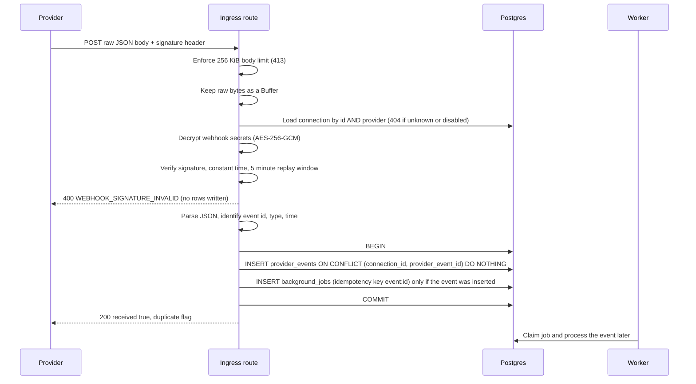

# Architecture

## Webhook ingress

Provider webhooks arrive at `POST /webhooks/:provider/:connectionId`.
The route is outside `/api/v1` and has no user authentication; the signature is the credential.
It lives in an encapsulated Fastify plugin with its own buffer JSON parser and a 256 KiB body limit.

## Guarantees

Invalid signatures never create a row, a job, or any other work.
The raw request bytes are verified, never a re-serialized body.
The event row is committed before the provider receives a 2xx.
Deduplication is decided by the `provider_events_connection_event_unique` constraint, so concurrent deliveries of one event produce exactly one event row.
The job is inserted in the same transaction as the event, so an event never exists without its job.
A duplicate delivery writes nothing, enqueues nothing, and still returns 200.
No event processing runs in the request handler; the worker owns it.
No external HTTP call happens inside the database transaction.
Unsupported event types are persisted with `normalized_type` set to `unsupported` so the worker can mark them ignored.
Logs carry the provider, connection id, and failure reason only; never the body, headers, signature, or secrets.

## Credentials at rest

Webhook secrets and API keys are stored as one AES-256-GCM blob in `provider_connections.credentials_ciphertext`.
The layout is a version byte, a 12-byte random IV, the ciphertext, and a 16-byte tag.
The connection id is bound as additional authenticated data, so a blob cannot be moved to another row.
The key comes from `CREDENTIALS_ENCRYPTION_KEY` (base64, 32 bytes) and is required in production.
At most two webhook secrets are kept per connection, so a rotation accepts the old and new secret together.
The connections API returns `hasWebhookSecret` and `hasApiKey` and never returns secrets or ciphertext.
Only sandbox API keys are accepted.
